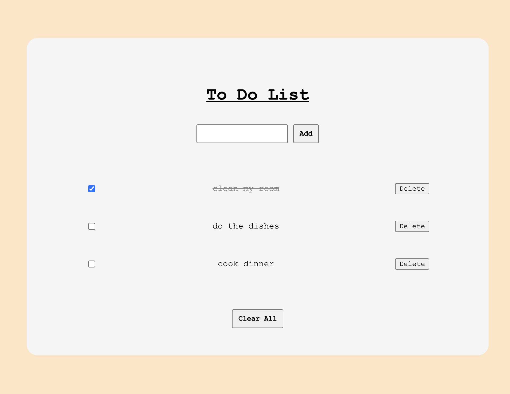

# Todo List

A simple, interactive to-do list application built with HTML, CSS, and JavaScript. Users can add tasks, mark them as completed, delete individual tasks, and manage their daily to-do list.

## Live Demo

**[View Live Application](https://anwaralshohatee.github.io/todo-list/)**

## Technologies


## Features

- Add new tasks to the list
- Mark tasks as completed using checkboxes
- Delete individual tasks
- Clear all tasks at once
- Prevent empty task submissions
- Dynamically update tasks without reloading the page

## Screenshot



## Getting Started

### 1. Clone the Repository

```bash
git clone https://github.com/AnwarAlshohatee/todo-list.git
cd todo-list
```

### 2. Run the Application

Open `index.html` in your browser.

No installation or additional dependencies are required.

## Future Improvements

- Save tasks using local storage
- Add task editing functionality
- Filter completed and pending tasks
- Improve mobile responsiveness

## Author

**Anwar Alshohatee**

[Portfolio](https://anwaralshohatee.netlify.app) | [LinkedIn](https://www.linkedin.com/in/anwaralshohatee/)
